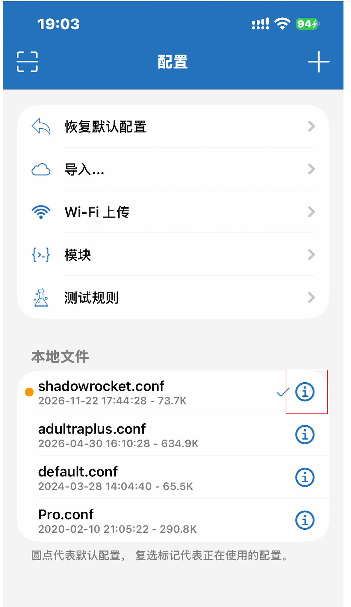
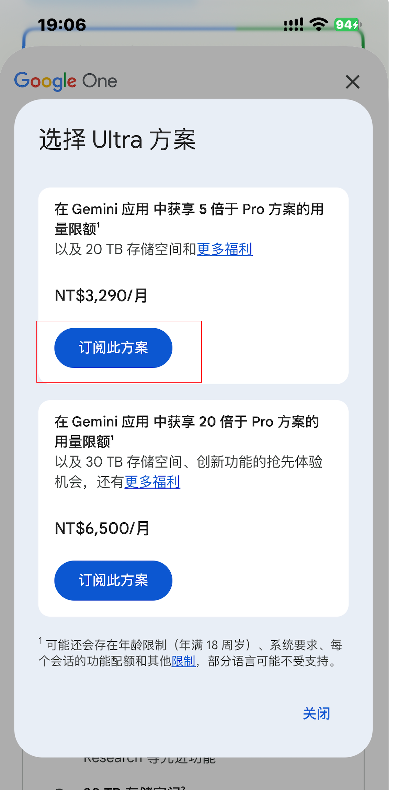

# g1-acq

[](https://t.me/muihbb)

> 💬 **AI羊毛交流群**:https://t.me/muihbb —— 交流 AI 优惠、订阅羊毛

Google One（iOS）订阅入口的商品 ID 改写与采集工具，适用于 **Shadowrocket / 小火箭**。

**G1 ACQ 已合并三档改写：原始 iOS 2TB → `g1.2tb.ai.annual` 年付测试，20TB / 30TB 保留原有优惠映射与独立回退。** 请删除手机上的旧 **G1 ACQ** 模块，添加下方唯一新主安装地址；模块名仍为 **G1 ACQ**。本次发布固定为 `v7.1.0`，响应脚本版本为 `g1-acq-v7.1`，完整安装、采集与实机核对步骤见 [Pro 年付测试与 SKU 扫描](docs/pro-annual-test.md)。

> 响应中出现商品 ID，只能证明页面携带该字符串，不等于 App Store 商品目录校验。改写命中也不等于商品可购买；商品名称、周期、初次与续费金额须在 App Store 收银台核对，权益以 Google One 账户实际状态为准。

## 主模块安装地址

**G1 ACQ：三档合并改写与本地结果页**

```text
https://cdn.jsdelivr.net/gh/GuangYiDing/g1-acq@v7.1.0/g1-acq-v7.sgmodule
```

在小火箭模块管理中删除手机上的旧 **G1 ACQ**，再添加上面的新地址并启用；首次安装也使用该地址。模块安装入口与内部响应、报告脚本均固定引用 `@v7.0.0`，无需单独添加脚本；安装后重新连接，再重新进入 Google App 的订阅页。

历史 `pro-annual-test-v1` / `pro-annual-test-v2` 标签保留且不移动；手机上已有这些版本的副本时停用即可。[G1 Pro Annual Test 兼容入口](g1-pro-annual-test.sgmodule) 引用同一 [g1-acq.js](g1-acq.js)，无需另外启用。

## 三档映射

脚本匹配 `one.google.com/ai?` 响应，按完整源 SKU 执行以下映射：

| 正文中的完整源 SKU | 默认目标 | 备用目标 |
|---|---|---|
| `g1.ios.2tb.` 前缀的完整 SKU | `g1.2tb.ai.annual` | 无 |
| `g1.ios.20tb.m.v2` | `g1.20tb.3months_ip_90p.acq` | `g1.20tb.3months_ip_75p.acq` |
| `g1.ios.30tb.ai.pro.m` | `g1.ai.ultra.3months_ip_90p.acq` | `g1.ai.ultra.3months_ip_75p.acq` |

2TB 年付测试的源商品是 **原始 iOS 2TB**，目标固定且没有备用档。20TB / 30TB 各自保留原有回退逻辑：只有该档默认 90p 目标未出现在原始响应正文、对应 75p 备用目标出现时才用 75p；90p 出现时优先用 90p，两个目标都未出现时仍用默认 90p。这是正文字符串判断，不是商店商品查询。三档都未命中时原样返回响应。

**验证状态：目前只证实匹配逻辑和脚本离线测试，iOS 实机下单尚待验证。** `g1.2tb.ai.annual` 在 Google Play 公开记录中对应 Pro、`P1Y`（一年）、`US$199.99`，不是已确认的 iOS 一折商品。

## 安装（Shadowrocket / 小火箭）

进入 **配置页 → 当前使用配置右侧的 (i) 图标 → HTTPS 解密**。



1. 在小火箭模块管理中删除手机上的旧 **G1 ACQ**，添加上面的 `v7.1.0` 新主安装地址并启用，首页保持 VPN 连接。
2. 从上述当前配置的 **(i)** 入口进入 **HTTPS 解密**，打开解密开关。已有可用且已受信任的 Shadowrocket 证书时直接沿用；尚未配置证书时，在该页生成并安装证书，再完成下两步。
3. 首次配置证书时，在 iOS **设置 → 通用 → VPN 与设备管理** 中完成 Shadowrocket 描述文件安装。
4. 首次配置证书时，在 iOS **设置 → 通用 → 关于本机 → 证书信任设置** 中开启对应 Shadowrocket 根证书的信任。
5. 在当前配置的 **HTTPS 解密 hostname 列表**中核对 `one.google.com`；模块通过 `%APPEND%` 追加该域名。这里是 HTTPS 解密列表，不是 DNS Hosts。
6. 安装模块、更改模块开关或解密配置后，重新连接小火箭，再重新进入 Google App 的订阅页面。

## 手机端使用流程

1. 只启用新地址安装的 **G1 ACQ**，保持 **G1 SKU Scan**、**G1 Pro Annual Test** 与历史 v1 / v2 副本停用，重新连接小火箭。
2. 打开 **Google App（彩色 G 图标）→ Google One 管理**，进入 **2TB / Pro** 方案进行年付测试；核对保留映射时，再分别打开实际提供的 **20TB / 30TB** 方案。
3. 进入订阅流程后，核对 App Store 收银台显示的商品名称、周期、初次与续费金额，并从[本地结果页](https://one.google.com/g1-sku-report)核对本次命中记录。



截图展示 20TB 入口；2TB 年付测试应打开 **2TB / Pro** 方案。账号、地区和版本会影响页面展示，以手机实际提供的方案为准。原生 StoreKit 界面自身不属于网页响应改写范围。

### 可选：采集原始 SKU

需要记录网页中的完整源 ID 时，添加 **G1 SKU Scan**：

```text
https://cdn.jsdelivr.net/gh/GuangYiDing/g1-acq@v7.1.0/g1-sku-scan.sgmodule
```

采集模块与内部脚本均固定引用 `@v7.0.0`。它读取 `one.google.com/` 响应中出现的 `g1.*` 与 `com.google.one.*` 字符串，按 ID 去重累计次数，最多保留 300 个 ID；跳过自带结果页，通过 `$done({})` 原样返回响应。手机只保存候选 ID、次数、时间与扫描状态，不查询 App Store，不发网络上报。

| 阶段 | G1 SKU Scan | G1 ACQ | G1 Pro Annual Test、历史 v1 / v2 副本与其它同页改写模块 |
|---|---|---|---|
| 采集原始 SKU | 开启 | 关闭 | 关闭 |
| 测试三档映射 | 关闭 | 开启 | 关闭 |

1. 采集时仅启用 **G1 SKU Scan**，停用 **G1 ACQ** 与重复改写模块，重新连接小火箭。
2. 从 **Google App → Google One 管理** 浏览实际提供的方案，再从[本地结果页](https://one.google.com/g1-sku-report)取得完整源 ID。
3. 采集完成后关闭 **G1 SKU Scan**，只启用新地址安装的 **G1 ACQ**，重新连接后按上面的测试流程核对。

## 本地报告与排错

**G1 ACQ** 与 **G1 SKU Scan** 都附本地结果页。在小火箭连接且当前阶段模块开启时，用 Safari 打开[查看本地结果](https://one.google.com/g1-sku-report)或[导出 JSON](https://one.google.com/g1-sku-report?format=json)。该精确路径及其 query 由 Shadowrocket 的 `http-request` 脚本在本机返回页面，不交给 Google 处理。

`test.version` 为生成记录的脚本版本，当前为 `g1-acq-v7.1`。`test.hitCount` 是三档总改写数，`test.annualHitCount` 仅统计 2TB 年付改写；`test.target` 仍专指 `g1.2tb.ai.annual`。`test.matchedFrom` 每行含 `{id, to, count, fallback}`：`to` 是该源本次实际目标，`fallback=true` 表示 20TB / 30TB 使用对应 75p 备用档。HTML 按行显示实际目标和备用状态。

`status=no-match` 仅表示三档都没命中，此时保留响应原样；若 2TB 没命中但 20TB / 30TB 命中，状态仍为 `rewritten`，须看 `annualHitCount` 判断年付测试。报告保留最近一次执行记录，按时间核对；根据采集结果确认完整源 ID，不推测新的 iOS SKU。报告兼容旧 v1 的仅 2TB 记录：旧行缺少 `to` 时补为 2TB 目标，缺少的 `annualHitCount` 从旧行次数计算。

当前脚本日志前缀为 `[g1-acq]`，按以下字段核对执行结果：

| 输出标记 | 含义 |
|---|---|
| `g1-acq-v7.1 hits=N annualHits=N` | 当前脚本版本、三档总改写数与其中 2TB 年付改写数 |
| `源 SKU → 实际目标 xN` | 逐行记录完整源 ID、本次实际目标与该源改写次数 |
| `fallback=75p` | 该行 20TB / 30TB 使用了正文中出现的对应 75p 备用档 |

若没有新记录，先核对 VPN 连接、模块开关、当前配置的 HTTPS 解密、证书安装与信任、`one.google.com` hostname，再从 Google App 重新打开方案，以新记录的 `test.version` 或日志核对 `g1-acq-v7.1`。完整字段、采集与实机记录模板见 [Pro 年付测试与 SKU 扫描](docs/pro-annual-test.md)。

## 工作范围与本地存储

| 工具 | 脚本匹配范围 | 行为 |
|---|---|---|
| G1 ACQ | `^https://one\.google\.com/ai\?` 的响应 | 三档完整 SKU 改写、20TB / 30TB 独立回退并保存最近执行记录 |
| G1 SKU Scan | `^https://one\.google\.com/` 的响应，跳过自带结果页 | 采集候选 ID，原样返回响应 |
| 本地结果页 | `https://one.google.com/g1-sku-report` 精确路径及其 query 的请求 | 本机显示采集结果、最近改写记录或导出 JSON |

- **脚本处理范围**：G1 ACQ 读取匹配页面的响应体；采集器读取匹配响应正文，保存候选 ID、次数、时间与扫描状态，不读取请求头或请求体，不保存完整响应正文。改写只修改商品 ID，不改价格字段，页面文字价格不替代 App Store 收银台金额。
- **实际外发行为**：当前脚本没有网络上报调用；G1 ACQ 写脚本日志，并与采集器、报告页共用手机本地 `$persistentStore`。Shadowrocket 脚本宿主提供网络与存储 API，当前代码未调用网络上报不等于宿主缺少外发能力。模块与脚本下载仍使用 GitHub / jsDelivr 地址。
- **MITM 范围**：模块只追加 `one.google.com`，其全站流量进入解密范围；页面改写受脚本路径限制。证书在设备生成、安装与信任，HTTPS 解密设置属于当前配置。
- **系统权限**：脚本没有申请定位、相册、通知的调用；使用过程包含小火箭 VPN 连接和 iOS 描述文件、根证书信任配置。
- **全局规则影响**：模块的 `[Rule]` 拦截全局 UDP 443，促使支持回退的 QUIC 请求改走 TCP，也会影响其它 App 的 HTTP/3 使用、速度或连通性。
- **版本与存储**：本次模块安装入口与全部内部脚本统一固定引用 `@v7.0.0`；历史 v1 / v2 标签保留且不移动。本地键仍为 `g1.sku.scan.v1`、`g1.pro.annual.test.v1`，`schemaVersion` 保持 `1`；结果页的 `?clear=1` 只清除这两个键。

## 文件

| 文件 | 用途 |
|---|---|
| [g1-acq-v7.sgmodule](g1-acq-v7.sgmodule) | G1 ACQ 新主模块，三档合并改写与本地结果页 |
| [g1-acq.js](g1-acq.js) | `g1-acq-v7.1` 响应脚本，完整 SKU 改写、独立回退与本地命中记录 |
| [g1-pro-annual-test.sgmodule](g1-pro-annual-test.sgmodule) | 引用同一主脚本的兼容入口，无需另外启用 |
| [g1-sku-scan.sgmodule](g1-sku-scan.sgmodule) | 网页 SKU 被动采集模块，附本地结果页 |
| [g1-sku-scan.js](g1-sku-scan.js) | 候选 ID 去重、计数与时间记录 |
| [g1-sku-report.js](g1-sku-report.js) | 本机 HTML 结果页、JSON 导出和两键清理 |
| [docs/pro-annual-test.md](docs/pro-annual-test.md) | 新主模块安装、可选采集、年付实机核对与扫描边界 |

## 离线验证

使用 Node.js 18 或更新版本，在仓库根目录执行：

```sh
node --test tests/sku-tools.test.cjs
```

离线检查以主脚本 [g1-acq.js](g1-acq.js) 为核心，覆盖三档完整编号匹配、2TB 固定年付目标、20TB / 30TB 的 90p 优先和 75p 独立回退、目标与备用均缺失时使用默认 90p、只有 20TB / 30TB 的页面、URL 范围、三档零命中、总改写数与 2TB 改写数、逐行报告目标与备用状态、旧 v1 报告兼容、存储异常、采集去重与上限、本地报告、导出字段和模块脚本版本。以实际执行输出核对结果；测试中的源编号是合成样本，不构成商店上架或实机购买证据。
